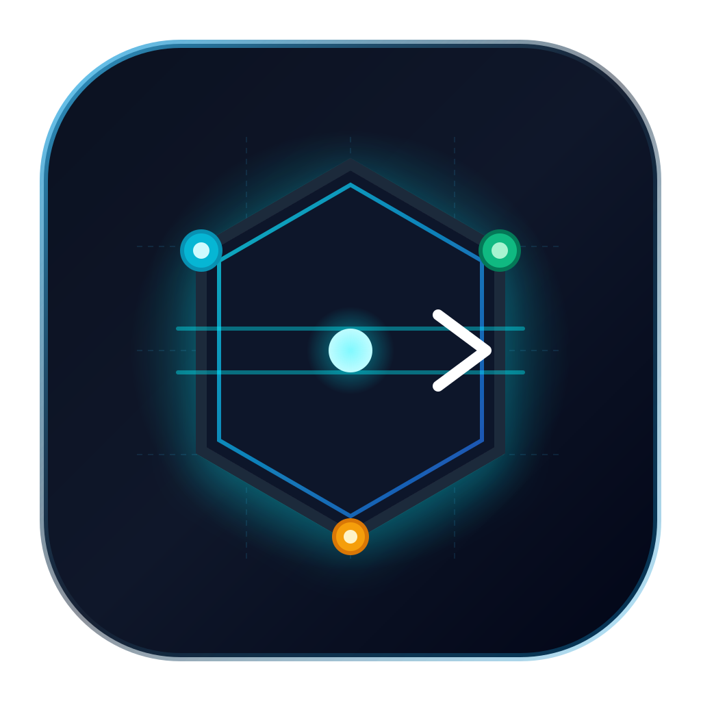

# ⚡ BeamREST

<p align="center">
  
</p>

<h3 align="center">High-Performance Offline-First Desktop REST &amp; API Workspace</h3>

<p align="center">
  <strong>Native Desktop (macOS, Windows, Linux) built with Tauri v2 + Rust Core + React 19</strong><br/>
  Ultra-fast, space-optimized API client engineered for raw speed, zero-cloud Git-native file persistence, seamless Postman v2.1 interoperability, and instant cURL parsing.
</p>

<p align="center">
  <a href="https://github.com/AMSComm/BeamRest/releases"></a>
  <a href="./LICENSE"></a>
  
  
  
  
</p>

---

## 💡 Why BeamREST?

Traditional API clients like Postman or Insomnia have evolved into heavy, bloated cloud platforms that require mandatory logins, throttle offline usage, consume gigabytes of RAM, and store collections in proprietary formats prone to painful Git merge conflicts. **BeamREST** is built from the ground up to restore developer freedom, speed, and privacy:

| Metric / Feature | Postman (Electron) | Insomnia / Heavy Clients | ⚡ BeamREST |
|:---|:---:|:---:|:---:|
| **Memory Footprint** | ~600MB - 1.2GB+ | ~300MB - 800MB | **< 35MB** (Zero runtime bloat) |
| **Cold Startup Time** | ~3.0s - 7.0s | ~1.5s - 3.5s | **< 0.25s** (Instant native launch) |
| **Offline & Cloud Policy** | Mandatory Cloud Sign-in / Tracking | Account Prompt / Cloud Sync | **100% Local & Offline-First (Zero Login)** |
| **Storage Architecture** | Monolithic JSON dump (Merge conflicts) | SQLite / Monolithic files | **Git-Native File-per-Request JSON Hierarchy** |
| **Secret & Token Security** | Synced to remote company servers | Stored in local or cloud DB | **Dual-Tier: Secrets in RAM / `.local.json` (Auto `.gitignore`)** |
| **cURL Import** | Multi-step modal navigation | Import menu dialog | **Instant: Paste raw cURL directly into URL bar** |
| **Proxy Support** | Complex configuration screens | Settings menu | **1-Click HTTP & SOCKS5 Toggle directly in Header** |
| **Installer / App Size** | ~150MB - 250MB+ | ~100MB+ | **~12MB (Ultra-compact native binary)** |
| **In-App Auto-Updates** | Forced background restarts | Manual or background | **Interactive GitHub Release Dialog with Changelog** |

---

## ✨ Key Capabilities & Showcase

### 1. ⚡ High-Throughput Pure Rust HTTP Engine
- Engineered on Rust's asynchronous `reqwest` and `tokio` runtime for raw socket performance.
- Completely bypasses browser CORS restrictions without needing clunky proxy extensions.
- Precision telemetry reporting: exact HTTP status code, real response execution time (in ms), payload size (in bytes), and complete header inspection.

### 2. 📁 Git-Native File-per-Request Storage
- Every request is stored as an individual, human-readable `.request.json` file inside its respective project folder.
- Group requests into projects and workspaces. Never suffer from monolithic collection conflicts when multiple team members commit API updates.
- Fast workspace switcher dropdown, inline workspace renaming, and instant directory loading.

### 3. 📋 Instant cURL Parsing & Live Auto-Updating cURL Tab
- **Paste cURL to Parse**: Simply paste any raw `curl -X POST ...` command directly into the URL bar. BeamREST instantly extracts the HTTP method, URL, query parameters, request headers, and request body (raw or JSON).
- **Live cURL Generator**: Click the dedicated **cURL** tab in the request editor to view a clean, copy-pasteable cURL command. As you edit query params, headers, or body fields, the cURL preview updates in real-time. Configured proxies (`-x http://...`) are automatically injected.

### 4. 🌐 Multi-Tier Variables, `{{var}}` Autocomplete & Secret Protection
- **Cascading Variable Resolution**: Automatically evaluates Environment Variables → Project Variables → Global Variables.
- **Interactive Autocomplete**: Type `{{` in the URL bar, Headers, or Query Params to trigger a real-time suggestions dropdown of available variables.
- **Dual-Tier Secret Isolation**: Variables flagged with `is_secret: true` mask their values in the UI (`••••••••`) with one-click momentary peek toggles. Sensitive values are stored strictly in memory and isolated `.local.json` files excluded from Git commits.

### 5. 📦 1-Click Postman Collection v2.1 Import & Export
- Migrate collections to and from Postman with zero friction.
- Point-and-click **Export to Postman Collection v2.1** with strict schema validation.
- Toggleable **Mask Secrets** switch in the export modal ensures sensitive tokens and passwords are not accidentally leaked when sharing collections with external teams.

### 6. 🌐 First-Class HTTP & SOCKS5 Proxy Integration
- Built-in proxy client supporting both HTTP and SOCKS5 endpoints (`http://127.0.0.1:8080`, `socks5://127.0.0.1:1080`).
- Quick proxy indicator button directly in the top header with real-time `ON` / `OFF` status.
- Configured proxy flags are immediately reflected in generated cURL commands and requests.

### 7. ↔️ Flexible Resizable Workspace & Keyboard-First Ergonomics
- Draggable panel dividers for both the sidebar and the request/response split view. Panel dimensions persist seamlessly across restarts via `localStorage`.
- Unsaved changes indicator dot on the Save button so you never lose pending edits.
- Press `Escape` at any time to instantly dismiss the topmost modal, dialog, or dropdown.
- Clean, focused interface with icon-only action buttons for maximum screen real-estate.

### 8. 🔄 Interactive In-App Auto-Updater & GitHub Release Pipeline
- Integrated with `tauri-plugin-updater` v2 targeting official GitHub releases at `AMSComm/BeamRest`.
- Checks for updates automatically or on-demand via the status bar.
- Displays full markdown release notes with a real-time download progress bar and 1-click relaunch.

---

## ⌨️ Keyboard Shortcuts

| Category | Shortcut (macOS) | Shortcut (Win / Linux) | Action |
|:---|:---|:---|:---|
| **Execution** | `Cmd + Enter` | `Ctrl + Enter` | **Execute active HTTP request** |
| | `Cmd + S` | `Ctrl + S` | **Save active request to disk** |
| | `Cmd + Shift + C` | `Ctrl + Shift + C` | **Copy request as cURL command** |
| **Workspace & Projects** | `Cmd + N` | `Ctrl + N` | **Create new request** |
| | `Cmd + Shift + N` | `Ctrl + Shift + N` | **Create new project / collection** |
| | `Cmd + O` | `Ctrl + O` | **Open workspace directory** |
| **Variables & Export** | `Cmd + E` | `Ctrl + E` | **Manage Workspace & Environment variables** |
| | `Cmd + Shift + E` | `Ctrl + Shift + E` | **Export to Postman Collection v2.1** |
| | `?` | `?` | **Open keyboard shortcuts cheat-sheet** |
| **Request Tabs** | `Option + 1` | `Alt + 1` | **Switch to Params tab** |
| | `Option + 2` | `Alt + 2` | **Switch to Headers tab** |
| | `Option + 3` | `Alt + 3` | **Switch to Body tab** |
| | `Option + 4` | `Alt + 4` | **Switch to Auth tab** |
| | `Option + 5` | `Alt + 5` | **Switch to Auto Extractors tab** |
| **Global Controls** | `{{` | `{{` | **Trigger variable autocomplete dropdown** |
| | `Escape` | `Escape` | **Close topmost modal, dialog, or dropdown** |

---

## 📁 Git-Native Workspace Hierarchy

BeamREST organizes your workspace as a clean, human-readable directory tree designed for effortless version control:

```
my-api-workspace/
├── .beamrest/
│   ├── workspace.json            # Workspace metadata, active environment ID, project list
│   └── state.local.json          # UI state, active tabs, panel widths (in .gitignore)
├── environments/
│   ├── dev.env.json              # Public environment variables (committed to Git)
│   ├── dev.env.local.json        # Secret environment values (in .gitignore)
│   ├── staging.env.json
│   └── prod.env.json
├── Auth-Service/                 # Project Folder 1
│   ├── project.json              # Project variables, default Auth rules
│   ├── 01-login.request.json     # Individual request definition
│   ├── 02-refresh.request.json
│   └── 03-logout.request.json
├── Payment-Service/              # Project Folder 2
│   ├── project.json
│   └── create-charge.request.json
└── .gitignore                    # Automatically excludes *.local.json to prevent secret leaks
```

---

## 📥 Download & Installation

Download official pre-built packages from [GitHub Releases](https://github.com/AMSComm/BeamRest/releases):

- **macOS:** `BeamREST-universal.dmg` (Universal binary for Apple Silicon M1/M2/M3/M4 & Intel)
- **Windows:** `BeamREST_x64-setup.exe` (NSIS Installer) / `BeamREST_x64.msi`
- **Linux:** `beamrest_amd64.deb` / `BeamREST.AppImage`

> 🔄 **In-App Auto-Update:** Built-in updater automatically detects new versions published to GitHub Releases, displays changelogs, tracks download progress, and relaunches the app in one click.

---

## 🛠️ Local Development & Testing

### Prerequisites
- **Node.js:** v20+
- **pnpm:** v10+ (`corepack enable pnpm`)
- **Rust & Cargo:** Stable toolchain (`rustup default stable`)

### Ubuntu / Debian System Dependencies
```bash
sudo apt update && sudo apt install -y \
  libwebkit2gtk-4.1-dev \
  build-essential \
  curl \
  wget \
  file \
  libxdo-dev \
  libssl-dev \
  libayatana-appindicator3-dev \
  librsvg2-dev
```

### Setup & Run
```bash
# Clone the repository
git clone https://github.com/AMSComm/BeamRest.git
cd BeamRest

# Install dependencies
pnpm install

# 1. Run web frontend in dev mode
pnpm dev

# 2. Run native desktop app (Tauri v2 + Rust Core)
pnpm tauri dev

# 3. Run automated tests
pnpm test                                        # Vitest unit test suite (11/11 passed)
cargo test --manifest-path src-tauri/Cargo.toml  # Rust core engine unit tests (5/5 passed)
pnpm run test:e2e                                # Full Playwright E2E suite (18/18 passed)
```

---

## 🏗️ Architecture & Project Structure

```
beamrest/
├── .github/workflows/
│   ├── release.yml             # Automated multi-platform CI/CD & GitHub release publisher
│   ├── sync-release-notes.yml  # Synchronizes release notes from CHANGELOG.md on release
│   └── test.yml                # PR & branch validation (cargo test + vitest + e2e)
├── src/                        # React 19 Frontend Workspace
│   ├── components/
│   │   ├── common/             # CodeEditor (CodeMirror 6), UpdateDialog, VariableInput
│   │   ├── layout/             # Header (workspace switcher, proxy, brand badge), Sidebar
│   │   ├── modals/             # Environment, Export, NewProject, NewRequest, Proxy, Shortcuts
│   │   ├── request/            # RequestPane, URL bar, Params, Headers, Body, Auth, Extractors, Live cURL
│   │   └── response/           # ResponsePane, telemetry bar, JSON viewer, headers inspector
│   ├── services/               # tauriApi (IPC bridges with Tauri invoke commands)
│   ├── stores/                 # useWorkspaceStore (Zustand state manager)
│   ├── utils/                  # cURL parser, updater utilities, formatters
│   └── types/                  # TypeScript interface specifications
├── src-tauri/                  # Rust 2021 Tauri v2 Desktop Engine
│   ├── capabilities/           # Tauri default capability ACL definitions
│   ├── icons/                  # Multi-platform native app icon suite (.icns, .ico, PNGs)
│   └── src/
│       ├── commands.rs         # Tauri IPC command entry points
│       ├── http_client.rs      # Reqwest HTTP/HTTPS client engine with proxy support
│       ├── storage.rs          # Git-native file-per-request I/O operations
│       ├── converter.rs        # Postman Collection v2.1 import & export serializer
│       ├── extractor.rs        # Auto token and response variable extractors
│       ├── lib.rs              # App initialization and updater plugin setup
│       └── main.rs             # Tauri application entry point
├── public/                     # App icon SVG, PNG, and static web assets
├── LICENSE                     # MIT License
└── CHANGELOG.md                # Detailed version release notes
```

---

## 🔒 Security & Privacy First

- **Zero Cloud Footprint**: BeamREST does not send your requests, collections, or environment data to any third-party server. Everything executes locally on your machine.
- **Strict Secret Isolation**: Secrets flagged as sensitive remain in RAM or isolated in `*.local.json` files automatically ignored by Git.
- **Export Scrubbing**: Postman exports offer an opt-in secret masking toggle so you never accidentally share production tokens or database passwords.

---

## 📄 License & Attribution

This project is open-source software licensed under the [MIT License](./LICENSE).

Developed and maintained by **AM Software** ([https://amsoftware.com.vn](https://amsoftware.com.vn)).
